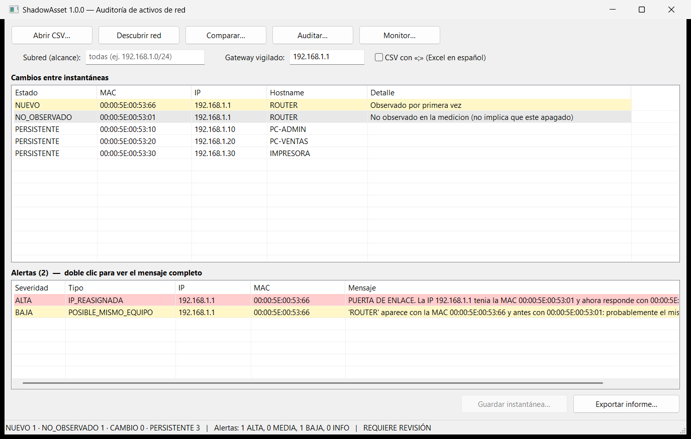

# ShadowAsset

**Descubrimiento de activos de red, detección de cambios y cumplimiento de inventario, en C.**

[](https://github.com/alexcrisdev/ShadowAsset/actions/workflows/ci.yml)


ShadowAsset responde tres preguntas que cualquier equipo de TI o de seguridad necesita contestar:

1. **¿Qué hay conectado a mi red?** (*discovery*)
2. **¿Qué cambió desde la última medición?** (*change detection*)
3. **¿Lo que veo coincide con lo que TI aprobó?** (*asset compliance*)

Detecta además indicios de **suplantación ARP**: si la MAC de la puerta de enlace cambia o dos MAC reclaman la misma IP. También señala dispositivos con **MAC aleatoria** y equipos que parecen "nuevos" pero probablemente son conocidos.

Es una herramienta **defensiva y pasiva**: no escanea, no envía paquetes y no necesita permisos de administrador. Se usa desde una **interfaz gráfica nativa de Windows** o desde la **línea de comandos**, para scripts y tareas programadas.



---

## Índice
- [Funcionalidades](#funcionalidades)
- [Inicio rápido](#inicio-rápido)
- [Interfaz gráfica](#interfaz-gráfica)
- [Comandos](#comandos)
- [Ejemplo: detección de suplantación ARP](#ejemplo-detección-de-suplantación-arp)
- [Alertas de seguridad](#alertas-de-seguridad)
- [Diseño de seguridad](#diseño-de-seguridad)
- [Calidad y pruebas](#calidad-y-pruebas)
- [Limitaciones](#limitaciones)
- [Documentación](#documentación)

## Funcionalidades

| Área | Qué hace |
|---|---|
| Descubrimiento pasivo | Lee la tabla de vecinos IPv4 de Windows (`GetIpNetTable2`) y la ruta por defecto (`GetIpForwardTable2`) sin generar tráfico. |
| Control de alcance | `--subnet 192.168.1.0/24` limita el análisis a la red autorizada. |
| Monitorización | `monitor` guarda instantáneas con fecha y compara cada una con la anterior; está pensado para el Programador de tareas. |
| Detección de cambios | Clasifica cada equipo como `NUEVO`, `NO_OBSERVADO`, `CAMBIO` o `PERSISTENTE` en tiempo O(n + m). |
| Cumplimiento | Contrasta lo observado con el inventario de TI: `NO_INVENTARIADO`, `DISCREPANCIA`, `NO_OBSERVADO`, `CONFORME`. |
| Alertas | Detecta conflicto de IP, cambio de MAC de una IP (crítico en la puerta de enlace), MAC aleatoria y posibles equipos repetidos. |
| Informes | Consola, CSV para Excel (`,` o `;`) y JSON para SIEM o scripts. |
| Trazabilidad | Cada informe registra versión, fecha UTC y **SHA-256** de cada archivo analizado. |
| Automatización | Códigos de salida `0` (sin novedades), `1` (error) y `2` (hay algo que revisar). |
| Interfaz gráfica | Ventana Win32 nativa: tablas con colores por gravedad y diálogos de Windows para abrir y guardar. Sin dependencias externas. |

## Inicio rápido

Requisitos: Windows 10/11 con [MSYS2](https://www.msys2.org/) (GCC UCRT64), o Linux con `gcc`/`clang` y `make`.

```powershell
# Windows: compilar y ejecutar las pruebas (también con Ctrl+Shift+B en VS Code)
powershell -ExecutionPolicy Bypass -File build.ps1 -Test

# Abrir la interfaz gráfica (o hacer doble clic en el .exe)
.\build\shadowasset-gui.exe

# O desde la línea de comandos, con los datos de ejemplo (ficticios, rango RFC 7042)
.\build\shadowasset.exe compare data\baseline.csv data\actual.csv
.\build\shadowasset.exe audit data\actual.csv data\inventario.csv
```

```bash
# Linux / WSL (solo línea de comandos)
make test && ./build/shadowasset compare data/baseline.csv data/actual.csv
```

## Interfaz gráfica

`shadowasset-gui.exe` ofrece lo mismo que la línea de comandos, sin escribir nada:

| Botón | Qué hace |
|---|---|
| **Abrir CSV…** | Muestra un inventario o una instantánea, con sus alertas. |
| **Descubrir red** | Lee la caché ARP (respetando el campo *Subred*). Después, **Guardar instantánea…** la guarda en un CSV. |
| **Comparar…** | Pide la instantánea anterior y la actual y muestra qué cambió. |
| **Auditar…** | Pide la medición y el inventario de TI y muestra qué no cuadra. |
| **Monitor…** | Elige una carpeta de historial: guarda una instantánea con fecha y la compara con la anterior. |
| **Exportar informe…** | Guarda el resultado en JSON o CSV (marque *CSV con «;»* para Excel en español). |

- Las filas se colorean según su gravedad: rojo = ALTA, naranja = MEDIA o cambio, amarillo = BAJA o equipo nuevo, gris = no observado.
- Doble clic sobre una alerta muestra su mensaje completo.
- Si el campo *Gateway vigilado* está vacío, se rellena solo con la puerta de enlace de este PC.
- También acepta argumentos (`shadowasset-gui.exe compare A.csv B.csv`) o arrastrar un CSV sobre el `.exe`.

Detalles técnicos: API Win32 en C puro (`ListView`, `Common Controls v6`, diálogos comunes) y texto Unicode. Incluye un *manifest* con estilos visuales, alta resolución (*DPI aware*) y `asInvoker` (nunca pide administrador). El ejecutable solo depende de DLL del sistema; esto se verifica en CI.

## Comandos

```text
shadowasset show     <archivo.csv>
shadowasset discover <salida.csv> [--subnet CIDR]
shadowasset monitor  <carpeta>    [--subnet CIDR] [--gateway IP] [--report F]
shadowasset compare  <anterior.csv> <actual.csv>     [--report F] [--sep ;] [--gateway IP]
shadowasset audit    <observado.csv> <inventario.csv> [--report F] [--sep ;] [--gateway IP]
shadowasset version
```

| Opción | Efecto |
|---|---|
| `--report F` | Guarda el resultado: JSON si `F` termina en `.json`; si no, CSV. Nunca sobrescribe. |
| `--sep ;` | Separador del CSV. Use `;` si Excel está configurado en español. |
| `--gateway IP` | IP crítica: si cambia de MAC, la alerta sube a `ALTA`. `monitor` la detecta solo. |
| `--subnet CIDR` | Descarta equipos fuera de la subred autorizada. |

**Monitorización continua.** Este comando, programado cada hora, crea `snapshot_AAAAMMDD_HHMMSS.csv` y avisa de cualquier cambio:

```powershell
.\build\shadowasset.exe monitor data\historial --subnet 192.168.1.0/24
```

Ver [docs/USO_PROGRAMADO.md](docs/USO_PROGRAMADO.md) para configurarlo con el Programador de tareas de Windows.

**Formato de entrada.** Basta un CSV con columnas `ip` y `mac`; `hostname` es opcional. Las columnas pueden ir en cualquier orden y se ignoran las extra (`responsable`, `ubicacion`…). Se aceptan archivos guardados por Excel: BOM UTF-8, `;`, CRLF y campos entre comillas.

## Ejemplo: detección de suplantación ARP

`data/actual_spoofing.csv` simula que la puerta de enlace responde con otra MAC, el síntoma típico de un ataque *man-in-the-middle* por ARP:

```text
> shadowasset compare data\baseline.csv data\actual_spoofing.csv --gateway 192.168.1.1

ESTADO            MAC                IP               HOSTNAME            DETALLE
NUEVO             00:00:5E:00:53:66  192.168.1.1      ROUTER              Observado por primera vez
NO_OBSERVADO      00:00:5E:00:53:01  192.168.1.1      ROUTER              No observado en la medicion (...)
PERSISTENTE       00:00:5E:00:53:10  192.168.1.10     PC-ADMIN
...
Alertas (2):
  [ALTA ] IP_REASIGNADA        192.168.1.1     PUERTA DE ENLACE. La IP 192.168.1.1 tenia la MAC
                                               00:00:5E:00:53:01 y ahora responde con 00:00:5E:00:53:66 (...)
  [BAJA ] POSIBLE_MISMO_EQUIPO 192.168.1.1     'ROUTER' aparece con la MAC 00:00:5E:00:53:66 (...)
```

Código de salida: `2`. Con `--report informe.json` se genera esto:

```json
{
  "herramienta": "ShadowAsset", "version": "1.1.0",
  "generado_utc": "2026-11-03T02:40:16Z", "comando": "compare",
  "ip_critica": "192.168.1.1", "requiere_revision": true,
  "entradas": [
    {"rol": "anterior", "ruta": "data/baseline.csv", "sha256": "…", "dispositivos": 4},
    {"rol": "actual", "ruta": "data/actual_spoofing.csv", "sha256": "…", "dispositivos": 4}
  ],
  "resumen": {"NUEVO": 1, "NO_OBSERVADO": 1, "CAMBIO": 0, "PERSISTENTE": 3},
  "hallazgos": [ … ],
  "alertas": [ {"tipo": "IP_REASIGNADA", "severidad": "ALTA", … } ]
}
```

## Alertas de seguridad

| Alerta | Severidad | Qué significa |
|---|---|---|
| `IP_DUPLICADA` | ALTA | Dos MAC reclaman la misma IP en una misma medición: conflicto de IP o suplantación ARP. |
| `IP_REASIGNADA` | ALTA si es la IP crítica; si no, MEDIA | Una IP conocida responde ahora con otra MAC: cambio de hardware, DHCP o suplantación. |
| `POSIBLE_MISMO_EQUIPO` | BAJA | Un equipo "nuevo" tiene el nombre de uno "no observado": probablemente cambió de MAC. |
| `MAC_ALEATORIA` | INFO | MAC administrada localmente (bit `0x02`): privacidad de móviles o máquina virtual. |

Las alertas son **indicios para revisión humana**, no veredictos. ShadowAsset nunca etiqueta un dispositivo como malicioso.

## Diseño de seguridad

La herramienta procesa datos que un atacante podría controlar (un CSV manipulado, un nombre de equipo malicioso), así que se diseñó con eso en mente. Detalle completo en [docs/MODELO_DE_AMENAZAS.md](docs/MODELO_DE_AMENAZAS.md).

- **Toda entrada es no confiable.** La IP, la MAC y el hostname se validan con listas blancas estrictas: sin ceros a la izquierda ambiguos, sin separadores mezclados y con caracteres de hostname permitidos de forma explícita.
- **Límites en todo**: 16 MB por archivo, 1024 bytes por línea, 32 columnas y 100 000 dispositivos. Además se rechazan bytes nulos y UTF-16.
- **Sin desbordamientos**: búferes de tamaño fijo con comprobación de longitud y sin `strcpy`/`sprintf` sobre datos externos. Se verifica con AddressSanitizer y UBSan en CI.
- **Inyección de fórmulas (CSV injection)**: los informes CSV escapan cualquier celda que empiece por `= + - @ TAB CR`.
- **Integridad y trazabilidad**: SHA-256 (implementación propia, verificada con vectores FIPS 180-4) calculado sobre los mismos bytes que se analizan, sin ventana TOCTOU.
- **No destruir evidencias**: las salidas se abren con `fopen("wx")` y nunca sobrescriben un archivo existente.
- **Mínimo privilegio y pasividad**: sin administrador, sin escaneo y sin tráfico de red (ni siquiera DNS).
- **Compilación endurecida**: `-Wall -Wextra -Wpedantic -Werror -Wconversion -Wshadow`, `-D_FORTIFY_SOURCE=2` y `-fstack-protector-strong`.

## Calidad y pruebas

```text
> build.ps1 -Test
[ OK ] validar_ip            [ OK ] csv_campo_seguro
[ OK ] validar_mac           [ OK ] sha256
[ OK ] validar_hostname      [ OK ] analisis_categorias
[ OK ] mac_local_y_subred    [ OK ] analisis_alertas
[ OK ] csv_dividir_linea     [ OK ] historial
[ OK ] csv_parsear
134 comprobaciones, 0 fallo(s)
```

- Pruebas unitarias sin dependencias ([tests/pruebas.c](tests/pruebas.c)): casos válidos, entradas maliciosas, límites y vectores oficiales de SHA-256.
- **CI en GitHub Actions** ([.github/workflows/ci.yml](.github/workflows/ci.yml)): Linux con gcc y clang, más ASan y UBSan; Windows con MSYS2; y una prueba de extremo a extremo que valida el JSON.

## Arquitectura

```text
            ┌────────────── fuentes ──────────────┐
            │ CSV (inventario, instantáneas)      │ caché ARP de Windows
            ▼                                     ▼
        csv.c ── valida ──► dispositivo.c ◄── descubrimiento.c
                                │
                       lista ordenada por MAC
                                ▼
                           analisis.c ──► hallazgos + alertas
                                ▼
                           informe.c ──► consola · CSV · JSON (+ SHA-256)
```

| Módulo | Responsabilidad |
|---|---|
| `dispositivo.c` | Modelo, validación/normalización de IP, MAC, hostname y subred; lista dinámica |
| `csv.c` | Analizador CSV (RFC 4180) con límites; escritura segura |
| `sha256.c` | Huella de los archivos de entrada |
| `analisis.c` | Comparación por fusión de listas ordenadas y motor de alertas |
| `informe.c` | Consola, CSV y JSON |
| `descubrimiento.c` | API IP Helper de Windows (pasiva) |
| `historial.c` | Nombres e historial de instantáneas |
| `registro.c` | Destino de los mensajes de error (consola o ventana) |
| `main.c` | Punto de entrada: línea de comandos |
| `gui.c` | Punto de entrada: interfaz gráfica Win32 |

Más detalle en [docs/ARQUITECTURA.md](docs/ARQUITECTURA.md).

## Limitaciones

- La caché ARP solo contiene equipos que **hablaron con este PC** recientemente. Que falte un equipo no significa que esté apagado.
- La MAC es la clave del dispositivo, pero puede falsificarse o cambiar (aleatorización). Por eso existen las alertas `POSIBLE_MISMO_EQUIPO` y `MAC_ALEATORIA`.
- Solo IPv4. El descubrimiento solo está disponible en Windows; el análisis funciona en cualquier plataforma.
- Las rutas con caracteres no ASCII pueden fallar en Windows (falta soporte `wchar_t`).

## Hoja de ruta

- [x] v0.1–v0.6: lectura de CSV, comparación, informes, descubrimiento, historial e inventario
- [x] v1.0: alertas de suplantación ARP, JSON con SHA-256, control de alcance, `monitor`, pruebas y CI
- [x] v1.1: interfaz gráfica nativa de Windows (Win32)
- [ ] Vecinos IPv6 (NDP)
- [ ] Fabricante a partir del OUI de la MAC (base IEEE local)
- [ ] Envío de alertas a syslog o Windows Event Log
- [ ] Rutas Unicode en Windows (`_wfopen`)

## Uso responsable

Use ShadowAsset solo en redes propias o en las que tenga **autorización explícita**. Aunque es pasiva, la información de inventario de red es sensible: no publique instantáneas reales (`data/historial/` está excluida de git).

## Documentación

- [docs/ARQUITECTURA.md](docs/ARQUITECTURA.md): diseño interno y decisiones técnicas.
- [docs/MODELO_DE_AMENAZAS.md](docs/MODELO_DE_AMENAZAS.md): amenazas consideradas y mitigaciones.
- [docs/USO_PROGRAMADO.md](docs/USO_PROGRAMADO.md): monitorización con el Programador de tareas.
- [docs/APRENDIZAJE.md](docs/APRENDIZAJE.md): conceptos de C y redes trabajados en el proyecto.
- [CHANGELOG.md](CHANGELOG.md): historial de versiones.

## Licencia

MIT. Ver [LICENSE](LICENSE).
